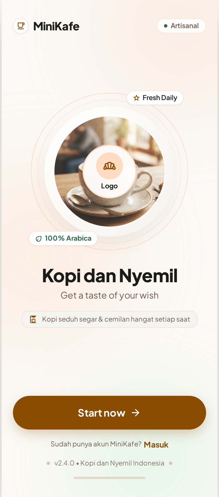
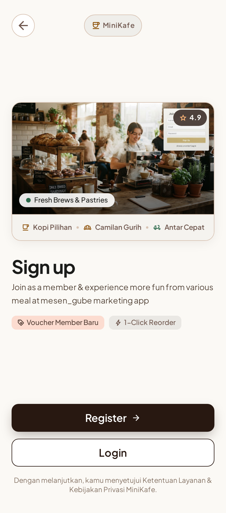
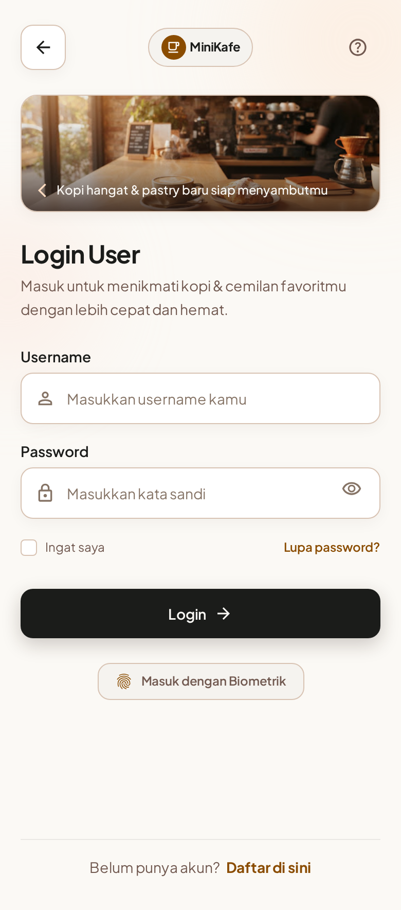
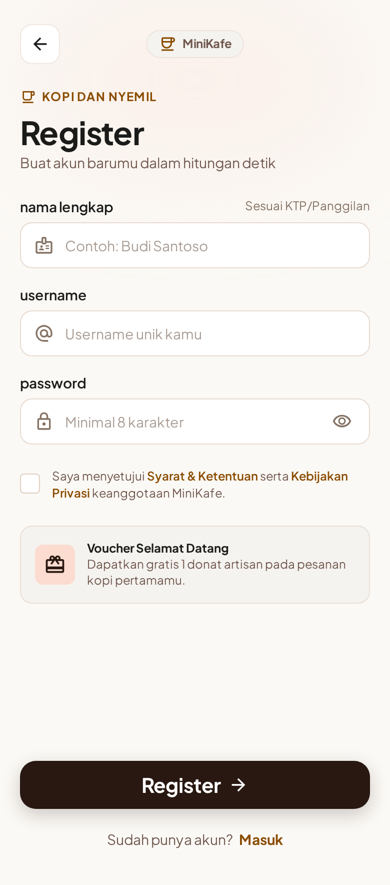
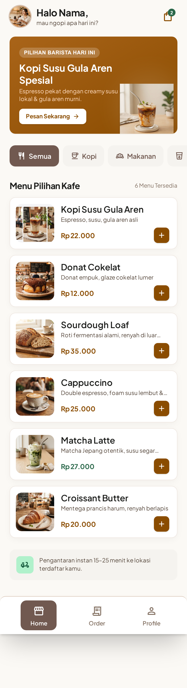
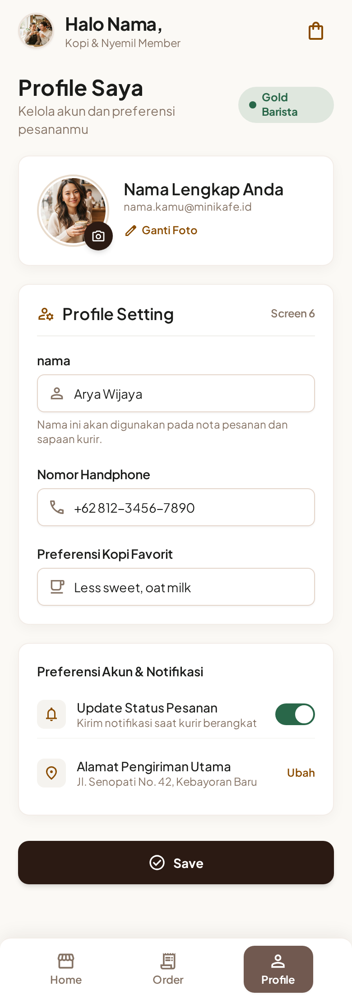
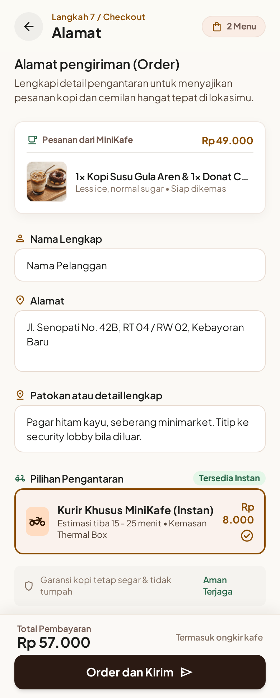
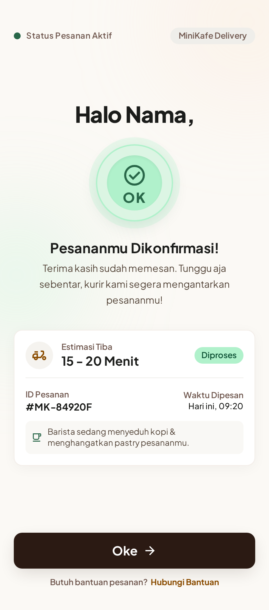

# MiniKafe (Kopi dan Nyemil) - Android Mobile App

Aplikasi mobile Android modern untuk pemesanan makanan dan minuman kafe (**MiniKafe**), dibangun berdasarkan rancangan desain sistem *Warm Artisanal Coffee* dengan alur lengkap 8 layar interaktif tanpa memerlukan database eksternal (menggunakan *in-memory static/dummy data*).

---

## Daftar Halaman & Fitur Aplikasi

Aplikasi mengimplementasikan **8 layar utama** sesuai alur wireframe dan rancangan desain Stitch:

1. **Splash / Welcome Screen (`view_splash.xml`)**
   - Branding visual **MiniKafe (Kopi dan Nyemil)**.
   - Tagline: *"Get a taste of your wish"*.
   - Tombol interaktif **"Start now"** untuk mengarahkan pengguna ke alur keanggotaan.

2. **Sign Up Hub Screen (`view_signup_hub.xml`)**
   - Halaman gerbang keanggotaan MiniKafe.
   - Ajakan ramah: *"Join sebagai member MiniKafe untuk mendapatkan promo pengiriman!"*.
   - Navigasi cepat: Tombol utama **Register** dan tombol outline **Login**.

3. **Login User Screen (`view_login.xml`)**
   - Form autentikasi bagi pengguna terdaftar.
   - Input field: `Username / Email` dan `Password`.
   - Opsi *Ingat saya*, bantuan *Lupa password?*, dan tombol **Login**.

4. **Register Screen (`view_register.xml`)**
   - Form pendaftaran akun baru: `Nama Lengkap`, `Username / Email`, dan `Password`.
   - Checkbox persetujuan *Syarat & Ketentuan MiniKafe*.
   - Tombol aksi **Register** yang langsung mendaftarkan member dan menyapa di Home.

5. **Home / Menu List Screen (`view_home_menu.xml`)**
   - Header personal: *"Halo [Nama], mau ngopi apa hari ini?"*.
   - Filter Kategori: **Semua**, **Kopi**, **Makanan**, **Minuman**.
   - **Daftar Menu Lezat (Dummy Data > 5 item)**:
     1. **Cappuccino** — *Espresso, susu steam, foam tebal & taburan kakao* (Rp 22.000)
     2. **Matcha Latte** — *Matcha Jepang otentik, susu segar* (Rp 27.000)
     3. **Kafe-Latte** — *Double espresso, foam susu lembut & latte art* (Rp 25.000)
     4. **Donat Cokelat** — *Donat empuk, glaze cokelat lumer* (Rp 12.000)
     5. **Sourdough Loaf** — *Roti fermentasi alami, renyah di luar* (Rp 35.000)
   - Tombol cepat tambah (+) pada setiap kartu menu untuk langsung masuk ke alur pemesanan.

6. **Profile Screen (`view_profile.xml`)**
   - Badge status keanggotaan: **⭐ Status: Gold Barista**.
   - Form pengaturan profil (*Profile Setting*):
     - `Nama Lengkap`
     - `Email / Username`
     - `Nomor Handphone`
     - `Preferensi Kopi Favorit` (*Less sweet, oat milk*)
   - Tombol **Save Perubahan** untuk menyimpan data ke memori lokal serta tombol **Keluar Akun**.

7. **Alamat Pengiriman / Order Screen (`view_order_address.xml`)**
   - Ringkasan pesanan & total pembayaran otomatis (termasuk ongkos kirim instan Rp 8.000).
   - Form rincian tujuan:
     - `Nama Penerima`
     - `Alamat Lengkap` (*Jl. Ace Tabrani No. 42B, RT 02 / RW 02, Bogor*)
     - `Patokan atau Detail Kurir`
   - Tombol **"Order dan Kirim"**.

8. **Konfirmasi Pesanan Screen (`view_order_confirmation.xml`)**
   - Badge sukses hijau segar dengan icon checkmark besar.
   - Header sapaan: *"Halo [Nama],"*.
   - Informasi pesanan:
     - **ID Pesanan:** `#MK-84920F`
     - **Waktu Dipesan:** `Hari ini, 09:20`
     - **Estimasi Tiba:** `15 – 20 Menit`
     - **Status:** *Diproses (Barista sedang menyeduh kopi & menghangatkan pastry pesananmu).*
   - Tombol **"Oke, Kembali ke Menu"** untuk kembali ke Home.

9. **Bottom Navigation Bar (`layout_bottom_nav.xml`)**
   - 3 Tab ergonomis: **Home**, **Order**, dan **Profile**.
   - Otomatis aktif dan memberi indikator tab yang sedang dibuka.

---

## 🎨 Desain & UI/UX

Mengacu pada panduan desain sistem **Warm Artisanal Coffee** di `DESIGN.md`:
- **Warna Utama:**
  - Caramel Amber (`#C87D32`): Tombol aksi utama, aksen harga, dan tab aktif.
  - Dark Roasted Espresso (`#2B1A13`): Typography heading dan tombol brand kontras tinggi.
  - Fresh Matcha Mint (`#3E7B5C` / `#EAF3EE`): Aksen status sukses dan konfirmasi.
  - Steamed Milk Cream (`#FBF9F5` / `#FFFFFF`): Background lembut yang nyaman di mata.
- **Komponen:**
  - Card dengan sudut melengkung halus (*rounded corner 12–16dp*).
  - Material 3 Buttons dengan haptic-ready states.
  - Input field terstruktur dengan border oat yang elegan.

---

## 🛠️ Teknologi yang Digunakan

- **Platform:** Native Android (Kotlin)
- **Min SDK:** 35 | **Target/Compile SDK:** 37
- **UI Framework:** Android Material 3 Design Components (`com.google.android.material`)
- **Layout System:** ConstraintLayout, LinearLayout, CardView, & RecyclerView
- **Data Persistence:** In-Memory Dummy Repository (`DummyRepository.kt`) tanpa ketergantungan backend/database luar.
- **Architecture:** Clean, Simple, Single-Activity pattern (`MainActivity.kt`) dengan dynamic container swapping yang ringan dan mudah dipahami.

---

## 📸 Screenshot Tampilan Aplikasi

| 1. Splash & Welcome | 2. Sign Up Hub | 3. Login User | 4. Register |
| :---: | :---: | :---: | :---: |
|  |  |  |  |

| 5. Home Menu | 6. Profile Screen | 7. Alamat Pengiriman | 8. Konfirmasi Pesanan |
| :---: | :---: | :---: | :---: |
|  |  |  |  |

---

## Cara Menjalankan Aplikasi

Aplikasi siap dijalankan langsung di Android Studio:

1. **Buka Project di Android Studio:**
   - Jalankan Android Studio.
   - Pilih menu **Open**, lalu arahkan ke direktori project `MiniKafe`.
2. **Sinkronisasi Gradle:**
   - Tunggu proses *Gradle Sync* selesai mengunduh dependensi Google & AndroidX.
3. **Pilih Perangkat (Device):**
   - Sambungkan smartphone Android dengan mode *USB Debugging* aktif, ATAU
   - Gunakan Android Virtual Device (AVD / Emulator) yang tersedia.
4. **Jalankan Aplikasi:**
   - Klik tombol **Run 'app'** (tombol play hijau) atau tekan shortcut `Shift + F10`.
5. **Eksplorasi Fitur:**
   - Mulai dari Splash -> Sign Up Hub -> Login / Register -> Pilih Menu di Home -> Isi Alamat Pengiriman -> Lihat Konfirmasi Pesanan!

